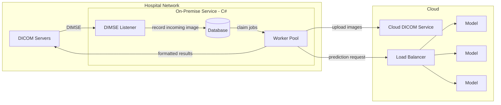
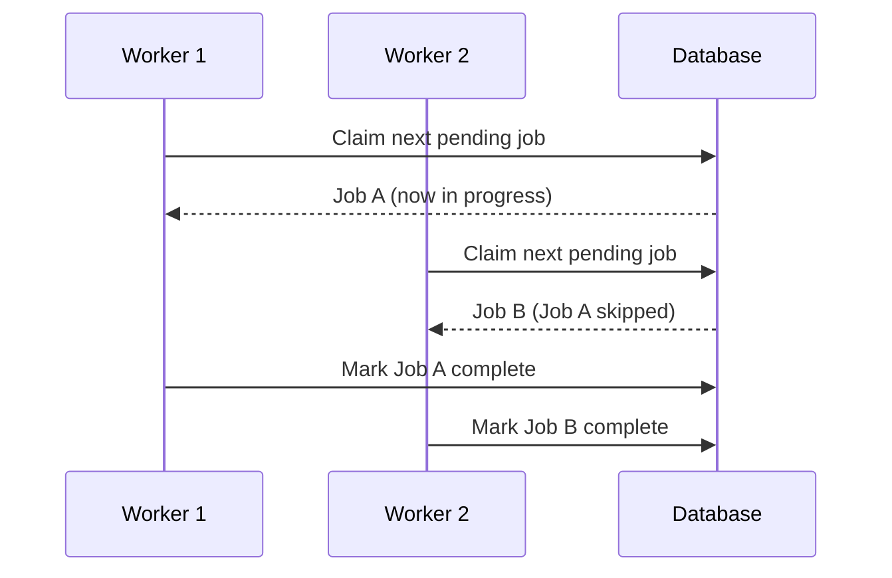
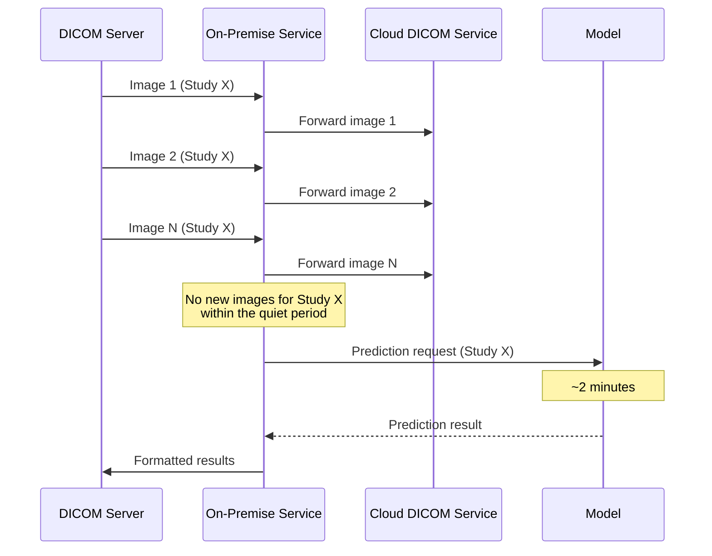

## Introduction

At a previous company I built an on-premise service that took medical images from inside a hospital network, sent them to an AI model in the cloud, and delivered the model's results back into the hospital's systems.

This post walks through how the pipeline worked, the decisions behind it, and the one lesson I most want to write down: **none of the code we wrote was the bottleneck. The model was.**

{/* truncate */}

The pipeline had to do four things:

- **Receive** DICOM images from the imaging systems inside the hospital
- **Forward** those images to a cloud-based DICOM service
- **Request a prediction** once a study had finished arriving
- **Return** the formatted results to the on-premise environment

## Why C# and .NET

Most hospitals ran our service on Windows servers, and those servers almost always had the .NET runtime installed. Writing the service in C# meant it fit into the environment IT teams already knew how to deploy, patch and monitor. We weren't asking a hospital to install and maintain an unfamiliar runtime just to run our software.

The .NET ecosystem also has good DICOM tooling. We used a C# DICOM library to talk to the hospital's DICOM servers over **DIMSE**, the network protocol DICOM devices use to send and receive images.

## High Level Design

## The Database as a Queue

The core of the service was a pool of workers running inside the same application. Rather than introduce a separate message broker, which would have been one more thing to install and support on a hospital server, we treated the database as the queue.

When an image arrived, the service wrote a record for it to the database. Workers then polled the database for pending work, claimed a job, processed it and marked it complete. Because every worker ran in the same process, scaling throughput on a given server was as simple as running more of them in parallel.

The important part of this pattern is that two workers must never claim the same job. The claim has to be a single atomic operation that both selects a pending job and marks it as in progress, so a second worker polling at the same moment skips over it.

Using the database as the queue gave us a few things for free:

- **Durability** - work survived a service restart, because the queue was just rows in a table
- **Visibility** - we could see exactly what state every image and study was in with a query
- **Simplicity** - one fewer moving part to deploy into an environment we didn't control

## Forwarding Images to the Cloud

As images arrived from the hospital's DICOM servers, the workers forwarded them to a cloud-based DICOM service. That gave the model a single place to read the full study from when it was time to run a prediction.

## Knowing When a Study Is Complete

A study is made up of many images, and they don't arrive all at once or with any signal that the last one has been sent. Running a prediction on a half-received study would give a wrong or incomplete result.

Our approach was to wait for a quiet period. Every time an image arrived for a study we updated when that study was last seen. Once a study had gone a set period of time without any new images, we treated it as complete and sent the prediction request.

## Returning the Results

When a prediction came back, the service formatted the response into something the hospital's systems could consume and injected it back into the on-premise environment, where clinicians could see it alongside the original images.

## The Bottleneck Was the Model

This is the part I most want to write down.

Each prediction took **around 2 minutes** to return. Everything we built around the model - receiving images over DIMSE, the worker pool, forwarding to the cloud, formatting and returning results - was fast by comparison. None of it was the bottleneck. The model was, and it sat outside my control.

We put a load balancer in front of the model so we could run multiple model instances, and that helped. But it's worth being precise about what it helped with. A load balancer increases **throughput**, not **latency**. With more model instances we could process more studies at the same time, but each individual study still took 2 minutes to get a result.

A quick way to see this:

| Model instances | Time for one study | Studies completed per hour |
| --- | --- | --- |
| 1 | ~2 minutes | ~30 |
| 3 | ~2 minutes | ~90 |
| 10 | ~2 minutes | ~300 |

Adding instances scales the right-hand column. It does nothing for the middle one. For a clinician waiting on a result for a single patient, the middle column is the one that matters.

The takeaway for me is to work out where the time actually goes before optimising anything. We could have spent weeks making the on-premise service faster and it wouldn't have moved end-to-end time in any noticeable way. When the slowest step is someone else's, the most useful things you can do are make sure your own system never adds to the wait, scale out to keep throughput up, and make the cost of that step visible to the people who can change it.

## Summary

- **C# on .NET** fit the Windows servers hospitals were already running
- **A C# DICOM library** handled communication with the hospital's DICOM servers over DIMSE
- **Multiple workers in a single app** processed images in parallel, using **the database as a queue**
- **Images were forwarded** to a cloud-based DICOM service as they arrived
- **A quiet period** with no new images signalled that a study was complete and ready for prediction
- **A load balancer** in front of the model let us run multiple instances to increase throughput
- **Results were formatted** and injected back into the on-premise environment
- **The model's ~2 minute prediction time** was the bottleneck, and scaling out improved throughput but not per-study latency
